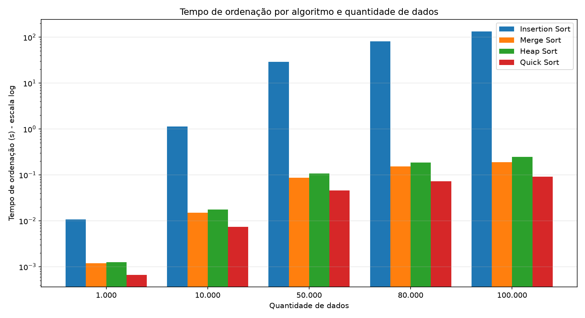

# APS – Estruturas de Dados (UNIP 2026/2)
## Sistema para Análise de Performance de Algoritmos de Ordenação de Dados

O contexto é o geoprocessamento das ~100 mil imagens de satélite da Floresta Amazônica que são catalogadas a cada 24 h. Cada número ordenado representa o código de uma imagem, no intervalo **0 a 99.999**.

---

## Como rodar

### 1. Clonar e instalar
```bash
git clone https://github.com/KAE4U/DataReader-with-Python.git
cd DataReader-with-Python
pip install -r requirements.txt
```
Precisa ter o **Python 3.9 ou superior** instalado. A única biblioteca externa é o `matplotlib`.

### 2. Versão simples (a que vamos usar na apresentação)
```bash
python aps_simples.py
```
- Ordena 1.000, 10.000, 50.000, 80.000 e 100.000 números aleatórios.
- Usa **Insertion Sort, Merge Sort, Heap Sort e Quick Sort**.
- Mostra o tempo de cada algoritmo para cada quantidade de dados.
- Gera `resultados_simples.csv` (abre no Excel) e `grafico_barras.png`.
- Leva **uns 4 minutos**, quase tudo por causa do Insertion Sort com 80 mil e 100 mil elementos. Não é travamento.

O cronômetro (`time.perf_counter()`) mede **só a ordenação**. O tempo de gerar os dados não entra.

### 3. Versão completa (opcional, para a monografia)
```bash
python main.py                      # menu interativo
python main.py --bateria interno    # todos os testes automaticamente
```
Além do que a versão simples faz, ela tem:
- 4 cenários: aleatório, já ordenado, invertido e semi-ordenado;
- leitura de arquivos `.txt` e `.csv` (`python main.py --gerar-arquivos` cria os arquivos de exemplo em `dados/`);
- entrada de valores digitados pelo usuário;
- listagem dos valores antes e depois da ordenação;
- os algoritmos Bubble Sort e Shell Sort, e o Timsort nativo do Python como referência;
- repetições com média, mínimo e máximo;
- tempo limite para os algoritmos lentos;
- histórico em CSV e vários gráficos, salvos em `resultados/`.

---

## Resultado de exemplo (versão simples)

Medido em um Intel Xeon Platinum 8488C com Python 3.11. **Cada membro deve rodar na própria máquina**, porque o enunciado pede a comparação em diferentes máquinas.

| Algoritmo | 1.000 | 10.000 | 50.000 | 80.000 | 100.000 |
|---|---|---|---|---|---|
| Insertion Sort | 0,0107 s | 1,1404 s | 28,93 s | 81,75 s | 133,79 s |
| Merge Sort | 0,0012 s | 0,0150 s | 0,0869 s | 0,1535 s | 0,1905 s |
| Heap Sort | 0,0013 s | 0,0177 s | 0,1076 s | 0,1872 s | 0,2491 s |
| Quick Sort | 0,0007 s | 0,0075 s | 0,0460 s | 0,0731 s | 0,0925 s |



O eixo Y do gráfico está em escala logarítmica. Sem ela, as barras dos algoritmos rápidos ficariam invisíveis perto das do Insertion Sort.

## Algoritmos

| Algoritmo | Melhor caso | Caso médio | Pior caso | Memória extra |
|---|---|---|---|---|
| Insertion Sort | O(n) | O(n²) | O(n²) | O(1) |
| Merge Sort | O(n log n) | O(n log n) | O(n log n) | O(n) |
| Heap Sort | O(n log n) | O(n log n) | O(n log n) | O(1) |
| Quick Sort | O(n log n) | O(n log n) | O(n²) | O(log n) |

## Estrutura do projeto
```
aps_simples.py     versão simples: um único arquivo
main.py            versão completa: ponto de entrada
aps/               módulos da versão completa (algoritmos, dados, benchmark, gráficos...)
testes/            testes de corretude:  python -m unittest discover -s testes
requirements.txt   dependências
```
